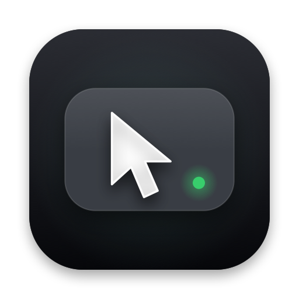

<p align="center">
  
</p>

<h1 align="center">CouchRemote</h1>

<p align="center"><b>Turn your iPhone into a trackpad, keyboard and media remote for your Mac, over Wi-Fi.</b></p>

## About

CouchRemote exists for one situation: the laptop is across the room (or closed, driving an external
monitor), you're in bed or on the couch watching YouTube or Netflix in a browser, and you don't want to
get up to pause, skip, fix the volume, or type a search. It's two small native apps:

- **RemoteMac**, a menu-bar agent on the Mac that turns what it receives into real mouse, scroll,
  keyboard and media-key events.
- **RemoteiPhone**, the controller: a full-screen multi-touch trackpad, a media bar, a keyboard that
  mirrors to the Mac (including the system keyboard's dictation), and a few conveniences for watching video.

**What it does**

- **Trackpad:** one-finger cursor with pointer acceleration, tap to click, double-tap, two-finger tap to
  right-click, two-finger scroll with momentum, pinch to zoom, and tap-then-hold-and-move to drag. Motion is
  sent once per display frame, so it stays responsive on a ProMotion screen.
- **Media and movie keys:** play/pause, seek, volume (via system media keys, so a browser's now-playing
  session responds) on one calm row; a pull-up **Controls** sheet holds fullscreen, mute, captions, Esc,
  previous/next tab, display brightness, zoom, the sleep timer and night mode.
- **Typing:** the real iOS keyboard, diffed against what's already typed, so autocorrect, predictive text
  and dictation revisions land correctly on the Mac. Emoji and any language work.
- **Several Macs:** pair your iPhone with more than one Mac and pick which to control. Nothing connects
  automatically; a dropped link resumes the same Mac for a few seconds, then gives up.
- **Sleep timer:** the Mac keeps it, so it still sleeps if your phone locks. Plus a night mode, and the
  phone is allowed to auto-lock after a few minutes.
- **Mac niceties:** keeps the display awake while a phone is connected, launch at login, accept/refuse
  connections, and a pairing window with a QR code.

**Security.** A remote that can type on your computer must not be open to the whole Wi-Fi network, and
laptops join café and office networks. So every connection is TLS 1.2 with a per-phone pre-shared key
(no plaintext fallback), keys are created by scanning a short-lived QR code and stored in the Keychain on
both sides, and the Mac only lets a phone take over after it proves which pairing it is. Details are in
[How pairing and security work](#how-pairing-and-security-work).

**How it's built.** Swift 6 and SwiftUI throughout, Network.framework for discovery (Bonjour) and the
encrypted transport, a small hand-rolled binary protocol, and **no third-party dependencies**. One shared
Swift package, `RemoteKit`, holds the wire protocol, pairing rules and transport, and is covered by unit
tests, including real TLS handshakes (right key, wrong key, unknown identity, plaintext peer). The Xcode
project is generated from `project.yml` with XcodeGen, and `scripts/release-mac.sh` produces a notarized,
stapled DMG for the Mac app.

**Scope.** This is a personal project, built for one person's couch. The iPhone app is installed from Xcode
and the Mac app is distributed as a notarized DMG outside the App Store, because it needs the Accessibility
permission and can't be sandboxed. It is not affiliated with or endorsed by Apple. Expect rough edges, and
read the code before running it on a machine you care about; the security model above is the part I'd
review first.

## Overview

```
RemoteiPhone ──TLS-PSK over TCP (Bonjour _couchremote._tcp)──▶ RemoteMac (menu-bar agent) ──▶ CGEvent / media keys
        └──────────────── Packages/RemoteKit (protocol, pairing, transport) ────────────────┘
```

| Path | What |
|---|---|
| `project.yml` | XcodeGen spec (versions, schemes, Info.plist keys). The `.xcodeproj` is generated and git-ignored. |
| `Packages/RemoteKit` | Wire protocol v2, framing, TLS-PSK transport, pairing rules/URL, Keychain store, tests. |
| `RemoteMac` | macOS 14+ menu-bar app (LSUIElement, sandbox off, hardened runtime on). |
| `RemoteiPhone` | iOS 17+ SwiftUI app. |
| `RemoteiPhone/Tuning.swift` | **All feel and timing constants** (pointer, scroll, taps/drag, reconnect window, idle-lock delay, sleep-timer choices). |
| `scripts/` | `release-mac.sh` (notarized DMG), `make-icons.swift` (draws the app icon and writes both asset catalogs: edit and re-run to restyle). |

## How pairing and security work

- **Nothing is trusted by default.** The Mac only accepts clients that hold a key it generated for them.
- **Transport:** TLS 1.2 with a pre-shared key (`TLS_PSK_WITH_AES_128_GCM_SHA256`). There is no plaintext
  fallback: a peer without a valid key fails the handshake. Session resumption and TLS false-start are
  disabled, so every connection proves its key in a full handshake.
- **Pairing:** on the Mac, menu → **Pair New iPhone…** shows a QR code for 5 minutes:
  `couchremote://pair?mac=<macID>&name=<name>&id=<pairingID>&key=<32 random bytes, base64url>`.
  Scan it in the app (**Pair another Mac**) or with the system Camera (it opens the app).
  The `pairingID` is the PSK identity; the key is the PSK.
- **Two-step trust:** after TLS, the phone's first message `hello` carries its protocol version, a stable
  device ID, its pairing ID and an HMAC proof under the pairing key. Only then does the Mac make it the
  active session, so a failed or half-open connection can never kick out the phone you're using.
- **Keys live in the Keychain** on both sides (never UserDefaults). The Mac stores its stable random
  `macID` there too (never derived from the hostname) and advertises it in the Bonjour TXT record, so the
  phone matches discovered services to paired Macs by ID, not name.
- **One phone at a time.** A second paired phone connecting replaces the first (which is told why, and
  does not fight back).

## Run it (development)

```sh
xcodegen generate          # brew install xcodegen if missing
open CouchRemote.xcodeproj
```

Signing: `project.yml` sets `DEVELOPMENT_TEAM: 5PYDBJJN92` with automatic signing. If Xcode shows "No
team", pick your team under **Signing & Capabilities** (and change it in `project.yml` so regeneration
keeps it). Keep signing consistent between rebuilds: macOS ties the Accessibility permission to the
code signature.

1. **Mac:** scheme **RemoteMac**, destination **My Mac**, ⌘R. A phone icon appears in the menu bar.
   Grant **Accessibility** (System Settings → Privacy & Security → Accessibility). If a rebuild drops it:
   select CouchRemote in the list, click **−**, then **+** and add the freshly built app
   (**Product → Show Build Folder in Finder → Products/Debug/CouchRemote.app**), switch it on, relaunch.
2. **iPhone:** scheme **RemoteiPhone**, destination your iPhone (not "My Mac"). Developer Mode must be on
   (Settings → Privacy & Security), and trust your developer profile on first launch (Settings → General →
   VPN & Device Management). Allow the **Local Network** prompt, and **Camera** when you first scan.
3. **Pair:** Mac menu → **Pair New iPhone…**, then in the app tap **Pair another Mac** and scan. The phone
   connects once right after pairing (that first connection is what completes the pairing on the Mac).

## Using it

- **My Macs** (home screen when not connected): each paired Mac shows Online/Offline (seen on Bonjour
  with a matching `macID`) and a **Connect** button. Long-press a Mac to **Rename** it (phone-side only);
  swipe or long-press to **Forget** it. **Nothing connects automatically.**
- **Connected:** the Mac name at the top is a menu: **Switch to <other Mac>** or **Disconnect**
  (which returns to My Macs and stays disconnected).
- **Resume rules:** if the link drops unexpectedly, the app retries the *same* Mac for 15 s
  ("Reconnecting…") then returns to My Macs. If you leave the app while connected, it reconnects to that
  same Mac when you come back; if you had disconnected, it stays disconnected.
- **Mac menu:** connected phone + **Disconnect**, **Accept connections** toggle (off = stop listening, stop
  advertising, and drop the current phone), **Pair New iPhone…**, **Paired iPhones** (Forget), sleep timer
  status with Cancel, **Launch at login**, Accessibility status/button, Quit.

| Gesture | Action |
|---|---|
| 1-finger drag | Move cursor |
| Tap / double-tap | Left click / double click (triple-tap = triple click) |
| 2-finger tap | Right click |
| 2-finger drag | Scroll (natural direction, with momentum) |
| Tap, then touch down again and move | Drag (button held until lift-off) |
| Pinch (two fingers apart / together) | Zoom the page in / out (⌘= / ⌘-), one step per `Tuning.pinchStepDistance` |

**Main screen:** the connection (Mac name, latency), a **keyboard** button (system keyboard with dictation,
mirrored live to the Mac, plus an Esc/Tab/arrows/⌘/Done row), a **•••** button, the trackpad, and one row of
playback buttons: seek ⏪/⏩ (arrow keys), play/pause, volume. Seek and volume fire on touch-down and repeat
while held.

**Controls sheet (•••):** **Fullscreen (F)**, **Mute (M)**, **Captions (C)**, **Esc**, **Prev/Next tab**
(⌃⇧⇥ / ⌃⇥); **Brightness** −/+ (the Mac's brightness keys: built-in and Apple displays respond, most
third-party monitors don't); **Zoom** −/reset/+ (⌘- / ⌘0 / ⌘=: browser page zoom); a **sleep timer**
(15/30/45/60/90 min, runs on the Mac so it still fires if the phone locks); and **night mode** (true black,
dim warm accents). The phone is allowed to auto-lock after 5 minutes without a touch.

### Tweaking the feel

- Cursor speed/acceleration, scroll gain, momentum, tap/drag thresholds, pinch step size and scroll-vs-pinch
  bias, hold-to-repeat timing, reconnect window, idle-lock delay: `RemoteiPhone/Tuning.swift`.
- Corner radii and animation curves/durations: `Radius` and `Motion` in `RemoteiPhone/Theme.swift`.
- Scroll backwards on the Mac: flip `invertScroll` at the top of `RemoteMac/InputInjector.swift`.
- Letter shortcuts assume a US/ANSI key layout (they send virtual key codes).

## Putting the Mac app on your personal laptop (notarized DMG)

One-time setup (done): a *Developer ID Application* certificate in the login keychain, and a notarytool
keychain profile named `couchremote` (`xcrun notarytool store-credentials couchremote` with an
app-specific password from account.apple.com; the script never sees any password).

```sh
scripts/release-mac.sh        # needs a clean git tree; takes ~5-15 min (two notarizations)
```

It runs `xcodegen generate` -> `xcodebuild archive` (Release) -> `-exportArchive` with
`scripts/ExportOptions.plist` (`developer-id`, Hardened Runtime on, no get-task-allow) -> checks the
signature/entitlements -> `notarytool submit --wait` -> `stapler staple` the app -> builds the DMG (app +
Applications link), signs it, notarizes and staples it too -> a final Gatekeeper check ->
`dist/CouchRemote-<version>.dmg`. It refuses to run with uncommitted changes. The version is
`MARKETING_VERSION` / `CURRENT_PROJECT_VERSION` in `project.yml`: bump it before each release. AirDrop the
DMG to the other Mac; because it is stapled it opens without Gatekeeper warnings, even offline.

### First launch on the personal Mac

1. Open the DMG, drag **CouchRemote** into **Applications**, launch it from there.
2. Grant **Accessibility** when prompted (System Settings → Privacy & Security → Accessibility).
   Allow **Local Network** if macOS asks. Turn on **Launch at login** in the menu.
3. Menu → **Pair New iPhone…** and scan the code from the iPhone app (**Pair another Mac**).
   Your iPhone can hold several Macs (work and personal); pick which to control on **My Macs**.

### Reset

- **Forget a phone on the Mac:** menu → **Paired iPhones** → Forget (it is disconnected immediately).
- **Forget a Mac on the phone:** My Macs → swipe left (or long-press) → Forget.
- Forget on **both** sides before pairing a device again, to avoid a stale entry on the other side.
- Full reset of the Mac: quit the app, then
  `security delete-generic-password -s com.adityakolte.couchremote.mac -a pairedPhones`
  (add `-a macID` to also generate a new Mac identity).

## Tests

```sh
cd Packages/RemoteKit && swift test     # codec, pairing rules, and real TLS-PSK handshakes over loopback
```

```sh
xcodebuild -project CouchRemote.xcodeproj -scheme RemoteMac -destination 'platform=macOS' build
xcodebuild -project CouchRemote.xcodeproj -scheme RemoteiPhone -destination 'generic/platform=iOS Simulator' build
```

DEBUG builds only: `COUCHREMOTE_DEBUG_PAIRING_URL_FILE=<path>` makes the Mac open a pairing invite at
launch and write its URL to that file, and `COUCHREMOTE_DEBUG_PAIR_URL=<url>` makes the phone app pair from
a URL at launch (used for simulator testing, which has no camera). Neither exists in Release builds.

## Wire protocol (v3)

Frame: `[u32 big-endian length][payload]`, payload `[u8 tag][fields…]`, max 1024 bytes. `hello`/`welcome`
begin with the protocol version so a mismatch is reported cleanly ("Update the other app"). Messages:
`hello` · `welcome` · `move` · `button` · `click` · `scroll` · `media` · `key(code, modifiers)` · `text` ·
`sleepTimer` · `macStatus` (tag/length/value, unknown entries skipped, so stage 3 can add now-playing,
volume and output device) · `disconnect(reason)` · `ping`/`pong`. Existing enum raw values never change,
only get appended. The version is bumped whenever appended values would trip up an older peer (v3 added zoom
keys and brightness media keys), so an out-of-date app shows "Update the other app" instead of dropping the
link: **after upgrading, update both the Mac app and the iPhone app.**
Details: `Packages/RemoteKit/Sources/RemoteKit/WireFormat.swift`.

## License

[MIT](LICENSE) © 2026 Aditya Kolte.
